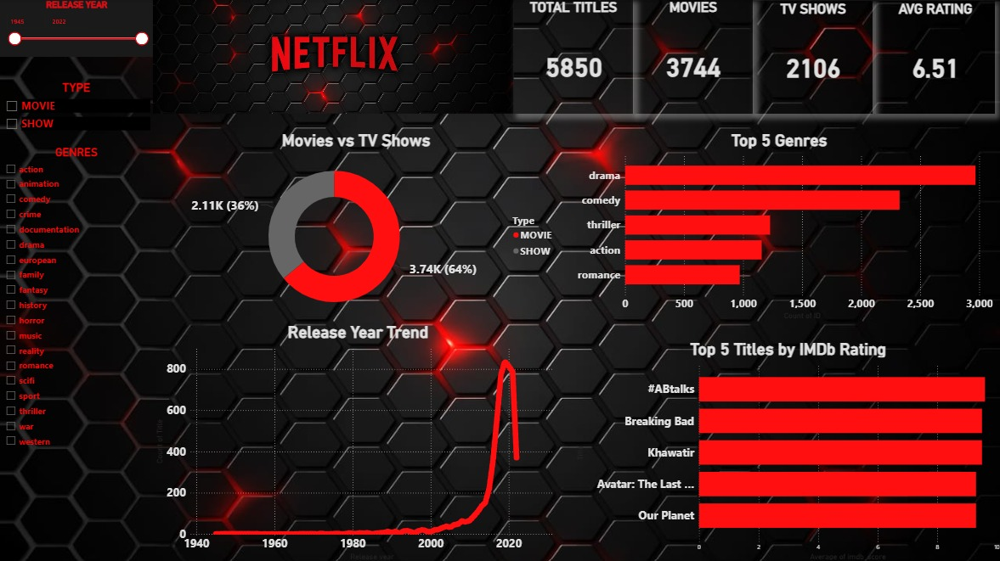

# Netflix Content Analytics Dashboard

## Project Overview

This project explores Netflix's content library to understand how its movies and TV shows are distributed across genres, how the catalog has changed over time, and how IMDb ratings vary across titles.

Using Power BI, I built an interactive dashboard to make these patterns easier to explore. The analysis focuses on content types, genre distribution, release years, catalog growth, and ratings.

The goal was to turn the available data into a clear picture of Netflix's content library and identify trends that could support further business analysis.

## Dashboard Preview

*Power BI dashboard exploring Netflix's content library, genre distribution, release trends, and IMDb ratings.*

## Business Questions

The analysis was guided by the following questions:

- Are movies or TV shows more common in the dataset?
- Which genres appear most frequently?
- How has the number of titles changed over time?
- How are IMDb ratings distributed across titles?
- Which release periods account for the largest share of the catalog?
- What can these patterns tell us about the composition of Netflix's content library?

## Tools and Technologies

- **Power BI:** Dashboard development and data visualization.
- **Power Query:** Data cleaning and transformation.
- **DAX:** Measures and calculations used in the dashboard.
- **Exploratory Data Analysis:** Examining content categories, release trends, and rating patterns.

## Key Metrics Analyzed

- Total titles
- Movies versus TV shows
- Genre distribution
- Content additions and release-year trends
- IMDb rating distribution
- Content growth over time

## Key Findings

### 1. Movies Make Up the Majority of Titles

Movies accounted for more than 70% of the titles in the dataset, making them the dominant content type compared with TV shows.

This shows that the catalog contains a substantially larger number of movies. However, the number of titles alone does not tell us which content type attracts more viewers or generates greater engagement.

### 2. Drama and Comedy Are Prominent Genres

Drama appeared most frequently in the genre analysis, followed by Comedy and Action.

This highlights the range of content represented in the catalog and provides a useful starting point for comparing genre distribution. Further analysis of viewing figures would be needed to determine which genres attract the largest audiences.

### 3. The Catalog Expanded Significantly After 2010

The data showed a substantial increase in content associated with later years, particularly between 2015 and 2020.

This makes the period worth examining more closely when studying the development of the catalog. However, release year and the year a title was added to Netflix are different measures, so they should not be treated as interchangeable.

### 4. High IMDb Ratings Were Less Common

The rating distribution showed that relatively few titles occupied the higher-rating ranges compared with the broader collection.

This provides a useful view of how ratings vary across the available titles. Ratings alone, however, do not explain why a title performs well or establish its commercial success.

### 5. Movies and TV Shows Offer Different Ways to Explore the Catalog

Although movies made up the larger share of titles, TV shows represented another important part of the content library.

Comparing the two categories by genre, release year, and rating can help reveal differences in the types of content available. Viewer engagement and retention would require additional data beyond the content catalog.

### 6. The 2015–2020 Period Stands Out in the Trend Analysis

The dashboard highlighted 2015–2020 as a period of substantial content growth in the analysis.

This period provides a useful reference point for exploring changes in the catalog. Additional information about licensing, production, and content additions would be needed to explain what drove the trend.

## Dashboard Features

The dashboard includes:

- Movies and TV shows comparison
- Genre distribution analysis
- Content and release-year trends
- IMDb rating distribution
- Interactive filters and slicers
- Visual summaries of the main findings

These features allow users to explore different parts of the catalog rather than relying on a single overall summary.

## Business Implications

The analysis provides a starting point for several business questions:

1. **Content mix:** How does the distribution of movies and TV shows align with Netflix's content strategy?
2. **Genre analysis:** Which genres deserve further investigation using viewing and engagement data?
3. **Catalog trends:** What factors contributed to changes in the content library over time?
4. **Content quality:** How do ratings vary across genres, release periods, and content types?
5. **Further analysis:** How could viewing hours, completion rates, and subscriber engagement help explain the performance of different titles?

These are areas for further investigation rather than conclusions that can be established from the content data alone.

## My Approach

I used Power Query to prepare the data and Power BI to explore the main content categories, genre patterns, release trends, and IMDb ratings.

I then organized the findings into an interactive dashboard so users could compare different parts of the catalog and identify patterns more easily.

This project helped me develop my ability to structure data, build meaningful visualizations, and connect analytical findings to relevant business questions.

## Skills Demonstrated

- Data cleaning and transformation
- Power BI dashboard development
- DAX measures and calculations
- Exploratory data analysis
- Genre and content distribution analysis
- Trend analysis and data visualization
- Business intelligence and analytical storytelling

## Limitations

The analysis is based on the fields available in the dataset. The presence of a title in the catalog does not indicate how often it is watched, how many subscribers it attracts, or how profitable it is.

Similarly, IMDb ratings represent ratings data rather than direct measures of Netflix viewer satisfaction. Viewing figures, subscriber behavior, licensing costs, and production costs would be needed to evaluate content performance more fully.

## About Me

I am an Economics undergraduate at the University of Port Harcourt with an interest in Data Analytics, Business Intelligence, and Business Analytics.

I enjoy using data to identify patterns, explain business performance, and present findings in a way that helps people make better-informed decisions.

**Tools:** Power BI | Power Query | DAX

**GitHub:** https://github.com/dbusiness-analytics

**LinkedIn:** https://www.linkedin.com/in/daniel-basil-60aa43363/

---

*This project demonstrates how Power BI can be used to explore a content catalog, identify patterns, and communicate findings through interactive visualizations.*

